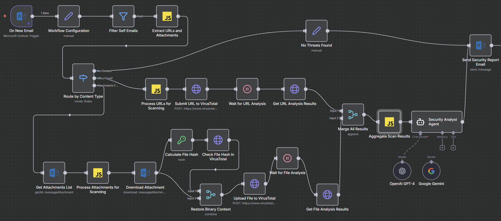
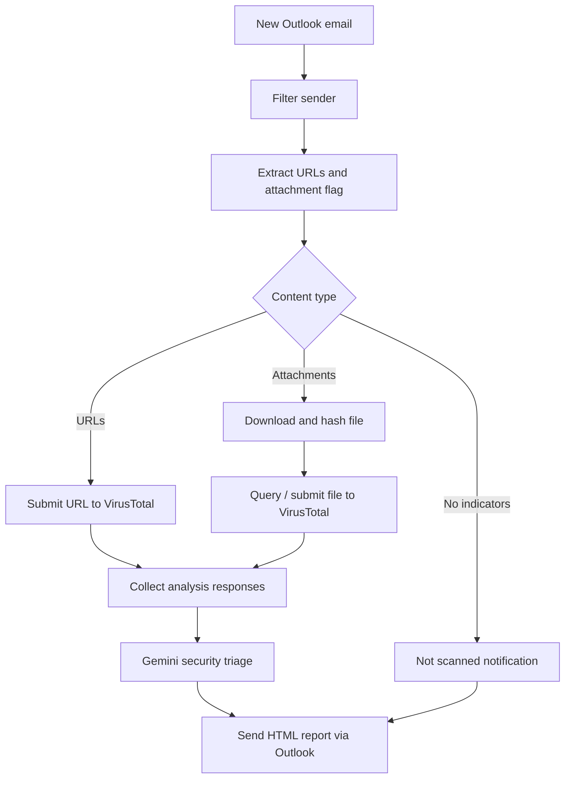

<div align="center">

# 🛡️ n8n Security Analyst Agent

**AI-assisted email threat triage with n8n, Microsoft Outlook, VirusTotal, and Google Gemini**

Monitor incoming email, extract URLs and attachments, request threat intelligence, and deliver a structured security summary to a designated mailbox.


[Quick start](#-quick-start) · [Architecture](#-how-it-works) · [Security](#-security-and-privacy) · [Documentation](#-documentation) · [Skill package](#-agent-skill-package)

</div>

> [!IMPORTANT]
> **Prototype / review required:** This workflow has not been end-to-end tested with live Outlook, Gemini, or VirusTotal accounts in this repository. A detection score is not a guarantee of safety. It may submit URLs and email attachments to a third-party service. Read the [security guidance](docs/SECURITY.md) before enabling it on real mailboxes.

## ✨ Highlights

| Feature | What the workflow currently does |
| --- | --- |
| 📬 Outlook event | Polls Microsoft Outlook for new messages |
| 🔗 URL analysis | Extracts URL candidates and submits them to VirusTotal |
| 📎 Attachment analysis | Downloads attachments, computes SHA-256, queries/submits to VirusTotal |
| 🤖 AI summarization | Uses a connected Google Gemini model to draft an HTML triage summary |
| 📤 Reporting | Sends the summary by Outlook email to a configurable recipient |
| 🧩 Agent integration | Includes a **skill scaffold** to assist with deployment and reviewing results |

**Built with:** n8n · Microsoft Outlook OAuth2 · VirusTotal API v3 · SHA-256 · Google Gemini · JavaScript · Python (local validation only)

## 🖥️ Workflow preview



*Screenshot from an earlier editing session. The checked-in JSON is the source of truth; some model icons in the screenshot may differ.*

## 🔁 How it works



See [Architecture](docs/ARCHITECTURE.md) for node-level details and limitations.

## 🚀 Quick start

1. **Prerequisites:** an n8n instance supporting the included node types, a Microsoft Outlook account with OAuth2 credentials, access to Google Gemini, and a VirusTotal API plan that permits your intended use.
2. **Import:** in n8n, import [`security-analyst-workflow.json`](security-analyst-workflow.json) using **Import from File**.
3. **Credentials:** assign your own Outlook OAuth2 credentials to the trigger, attachment and send nodes, and your Google Gemini credentials to the language model node.
4. **Configuration:** for self-hosted deployments, set `VIRUSTOTAL_API_KEY` and `SECURITY_REPORT_EMAIL` in the n8n process environment. See [Setup](docs/SETUP.md) for permission requirements and alternatives if `$env` access is blocked.
5. **Review:** inspect the file-upload branch, outbound network requests, rate limits and recipient before enabling the trigger.
6. **Test:** use a dedicated test mailbox, harmless URLs and dummy attachments; review each node's execution output. Only then consider enabling the workflow for a limited scope.

```bash
# Validate the repository export locally (no API keys required).
python scripts/validate_workflow.py
python -m unittest discover -s tests -v
```

> [!CAUTION]
> VirusTotal states that its **public/free API cannot be used in commercial products or services**. If you commercialize this integration, secure an appropriate licensed plan or written permission and review all provider terms. See [Marketplace readiness](docs/MARKETPLACE.md).

## 📁 Repository structure

```text
n8n-security-analyst-agent/
├── security-analyst-workflow.json    # Importable n8n workflow
├── assets/
│   └── workflow-overview.png        # Existing workflow screenshot
├── docs/
│   ├── ARCHITECTURE.md
│   ├── SETUP.md
│   ├── SECURITY.md
│   └── MARKETPLACE.md
├── skills/email-threat-triage/
│   ├── SKILL.md                      # Agensi-compatible skill scaffold
│   └── references/                  # Usage and safety references
├── scripts/
│   ├── validate_workflow.py         # Static workflow checks
│   └── package_skill.py             # Build skill ZIP
├── tests/                            # Offline unit tests
├── .github/                          # CI and contribution templates
└── README.md
```

## 🔐 Security and privacy

- **No committed API tokens.** The workflow resolves its VirusTotal key from the host's environment at runtime. n8n instance access and execution logs still require protection.
- **Outbound uploads:** the file branch sends attachment content to the standard VirusTotal API. Never use it for private or regulated material without assessing authorization and the applicable data handling terms.
- **Non-final results:** a fixed delay does not guarantee an analysis is complete. Pending/error responses are **inconclusive**, not clean.
- **URL extraction:** uses a lightweight regular expression, not a full RFC-compliant URL parser.
- **Untrusted input:** prompt injection, HTML injection, file-name mapping, and spam loops all require integration testing.
- **Credentials:** use minimum-privilege Outlook OAuth2 access, a dedicated reporting mailbox and access controls around n8n.

Read [Security & privacy](docs/SECURITY.md) and [Known limitations](docs/ARCHITECTURE.md#known-limitations).

## 📦 Agent skill package

An optional `SKILL.md` based skill scaffold is included for agent-assisted setup and triage. This is **not** a hosted scanner: it requires the buyer's own n8n instance and authorized integrations.

```bash
python scripts/package_skill.py
# Produces dist/email-threat-triage-skill.zip
```

The generated ZIP includes `SKILL.md`, a copy of this workflow JSON, and written setup/safety references. **Do not sell or publish a paid integration until API licensing, secret management, privacy and real-world tests have been resolved.** Details: [Marketplace guide](docs/MARKETPLACE.md).

## 📚 Documentation

- [Installation & configuration](docs/SETUP.md)
- [Architecture & failure modes](docs/ARCHITECTURE.md)
- [Security, privacy & threat model](docs/SECURITY.md)
- [Agensi packaging & commercialization checklist](docs/MARKETPLACE.md)
- [Contributing](CONTRIBUTING.md) · [Reporting a vulnerability](SECURITY.md) · [Changelog](CHANGELOG.md)

## 👤 Author

**Soulaimane ED-DAHMANI** · [GitHub](https://github.com/soulaimane-edh)

## 📜 Rights

Copyright © 2026 Soulaimane ED-DAHMANI. **All rights reserved.** This repository does not currently grant an open-source license. See [LICENSE](LICENSE). To reuse or redistribute the workflow or package commercially, request permission from the author. Third-party services and logos are subject to their respective terms.

---

<div align="center"><sub>Automated triage is decision support, not a replacement for a qualified security analyst.</sub></div>
